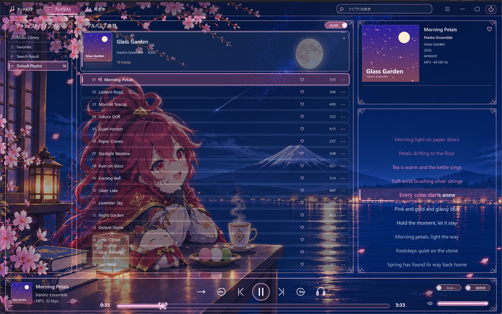
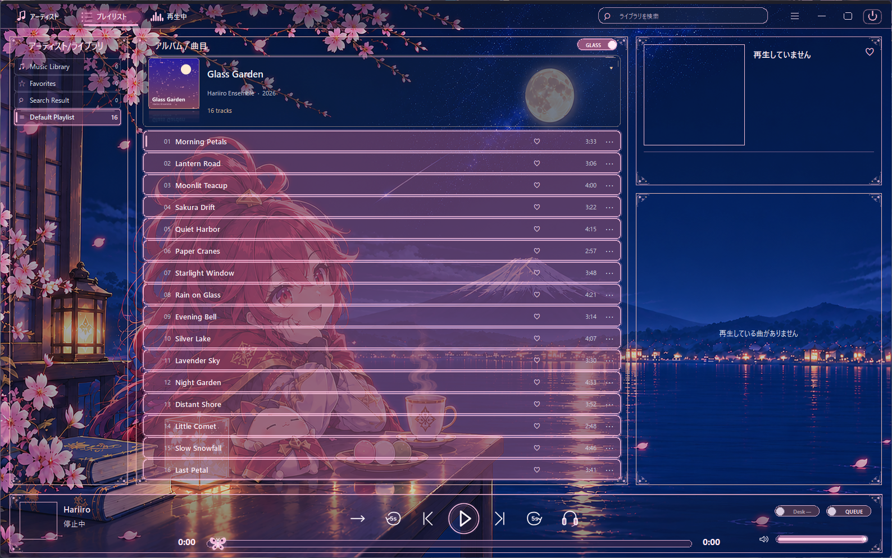
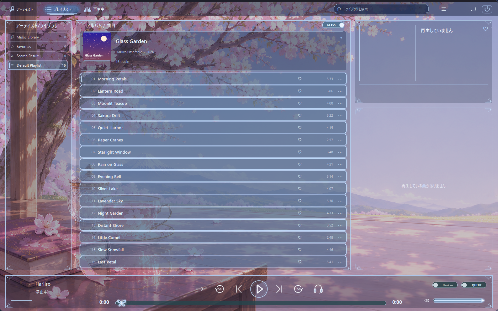

# Hariiro

[English](README.md) | [简体中文](README.zh-CN.md) | 日本語

**Panels UI (reborn)** と JS Panel で作った foobar2000 用の透明な「ガラス」スキンです。ジャケットと反射付きの
ガラスのプレイリスト、アーティスト / ライブラリ / プレイリストのナビゲーション、元に戻せる再生キュー、
ローカル歌詞（ESLyric が保存したファイルとタグ、曲ごとのずれ調整）、画像の再生コントロール、フォルダーで
追加できるアクセントカラー（`images/controls/`、6 色同梱）、壁紙の選択（`images/wallpapers/`）、
9 つの表示言語（English、Español、Português、简体中文、繁體中文、日本語、Français、Deutsch、Русский）。
新規インストールでは GLASS モードで起動します。

現在のバージョン：**1.0.0**（2026-11-22）。このリポジトリでの最初の正式版です。foobar2000 2.26.3、
foo_js_panel 1.9.2、Panels UI (reborn) 1.27.1 で確認しています。スクリーンショットは架空のサンプル
アルバムです。

## インストール

1. [foobar2000](https://www.foobar2000.org/) v2（64 ビット）をインストールして一度起動します。foobar2000 は
   同梱していません（ライセンス上、再配布できるのは改変していないインストーラーだけです）。
2. Release の `Hariiro.zip` をダウンロードして展開し、**`Install-Hariiro.cmd`** をダブルクリックします。
   foobar2000 を見つけ、終了する前に確認し、足りなければ `components\` から Panels UI (reborn) と JS Panel を
   追加し（インストール済みのものは置き換えません）、`Hariiro\` を `<profile>\foo_ui_panels-skins\Hariiro` に
   コピーして（既存のものは先にバックアップ）、foobar2000 を起動します。設定やプレイリストは変更しません。
3. 初回起動で 2 回クリック：「New user interface module(s) found」で **Panels UI (reborn)** を選び、
   メニューの **View → Panels UI → スキン（Skins）→ Hariiro** を選びます（Panels UI は最初に独自の
   レイアウトウィザードを開きます）。

手動インストール、元に戻す方法、言語の切り替え、すべての操作：[`docs/USER_README.ja.txt`](docs/USER_README.ja.txt)
（ZIP 内では `Hariiro-README.ja.txt`）。

## 主な機能

- **GLASS モード**：アルバムごとの透明なプレイリスト。ジャケット、反射、お気に入りのハート付き。foobar2000 自身の
  NATIVE 表示にも切り替えられます。
- **サイドバー**：アーティストまたはプレイリスト。作成、名前変更、複製、削除、フォルダーの追加。Ctrl / Shift +
  クリックで複数選択し、Delete で削除。
- **ドラッグ＆ドロップ**：曲をプレイリストやキューへ。エクスプローラーからファイルやフォルダーを追加すると、
  並べ替えて重複をスキップします。
- **ライブラリ検索**、**お気に入り**、**再生キューパネル**（ドラッグで並べ替え、ゴミ箱で削除、クリア）。
- **歌詞**：同期歌詞と通常の歌詞、ドラッグで移動、曲ごとに 0.5 秒早く / 遅く、ESLyric のデスクトップ歌詞の
  オン / オフ。
- **元に戻す**：削除したプレイリスト、曲、キューの項目を 8 秒の通知または **Ctrl+Z** で復元。
- **アクセントカラー**と**壁紙**はフォルダー / 画像を置くだけで追加でき、**9 言語**に対応（メニュー ☰ →
  スキンの言語）。

## ライセンス

[MIT License](LICENSE)、Copyright (c) 2026 zainchung。スクリプト、レイアウト、ドキュメント、同梱のすべての画像
（コントロール、角、2 枚の壁紙）に適用されます。改変版で「Hariiro」の名前を使う権利は含みません。Release の ZIP
には Panels UI (reborn) と foo_js_panel をそれぞれの MIT ライセンスのまま同梱しています（`components\`、
`THIRD-PARTY-NOTICES.txt`）。foobar2000 と ESLyric は同梱していないので、それぞれのライセンスに従って
別途インストールしてください。

開発者向けの情報（リポジトリ構成、テスト、パッケージ作成）は英語の [README](README.md) を参照してください。
