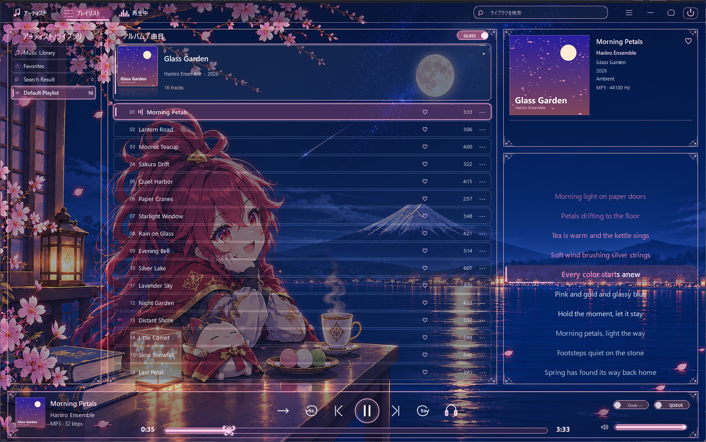
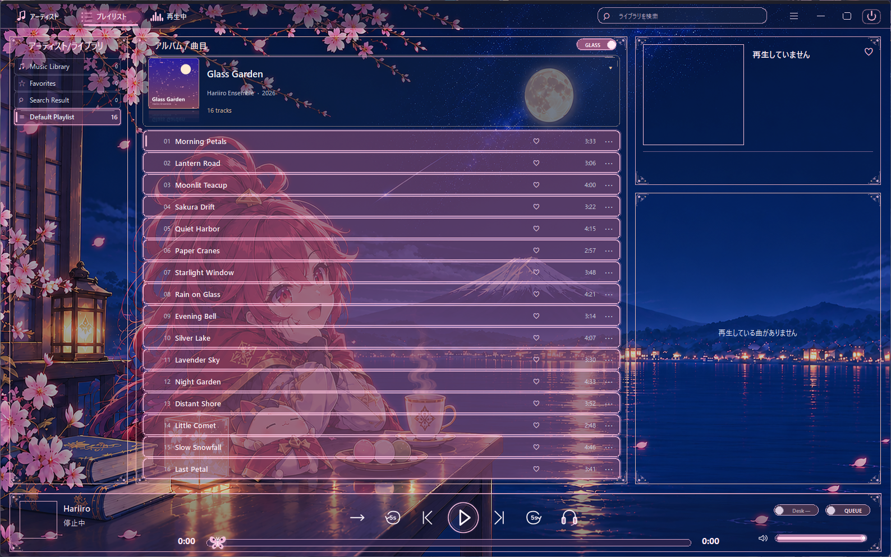
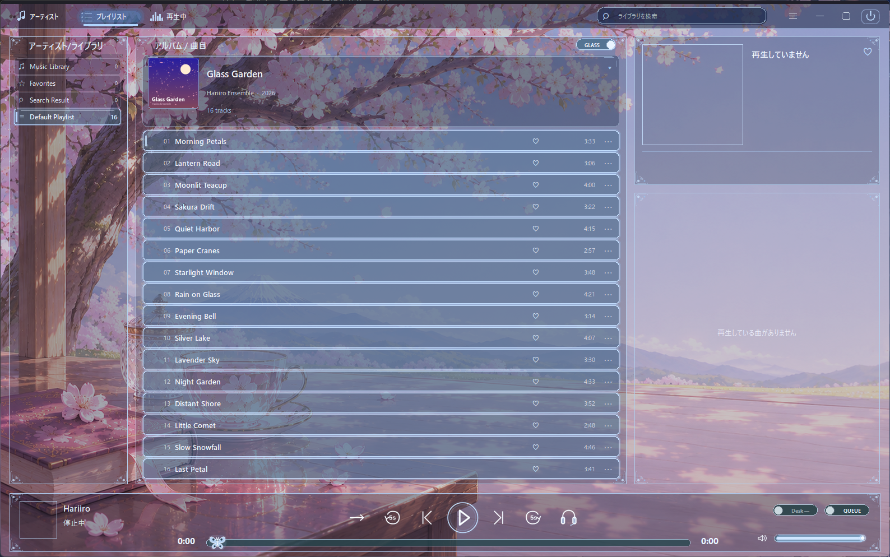

# Hariiro

English | [简体中文](README.zh-CN.md) | [日本語](README.ja.md)

A transparent "glass" skin for foobar2000 built on **Panels UI (reborn)** and JS Panels:
Glass playlist with album art and reflections, Artist/Library/Playlist navigation,
playback Queue with undo, local lyrics (ESLyric-saved files and tags, per-track offset),
image-based transport controls, accent colours as folders in `images/controls/` (six bundled; add your own),
a wallpaper selector (`images/wallpapers/`) and nine UI languages
(English, Español, Português, 简体中文, 繁體中文, 日本語, Français, Deutsch, Русский). New installs start in GLASS mode.





Current release: **1.0.0** (2026-11-22), the first release in this repository. Tested with foobar2000 2.26.3, foo_js_panel 1.9.2 and Panels UI (reborn).

**Windows status.** Every change is checked in a real foobar2000 on Windows; the full
acceptance matrix is `docs/WINDOWS_UI_ACCEPTANCE.md`. Covered offline only: display scaling
other than the test machine's (125 % / 150 %, moving between monitors, the 2x icons and the
seek bar / lyrics card child windows at those scales), Japanese IME pre-edit, NATIVE
middle-list behaviour, the undo notice's 8-second expiry, and the GLASS default on a first
run. Known limits: ESLyric cannot be embedded in a Panels UI panel (the skin reads saved
lyrics only), and NATIVE list rules are decided by the host (`docs/NATIVE_VS_GLASS.md`).

## License

Released under the [MIT License](LICENSE), Copyright (c) 2026 zainchung. This covers the
scripts, layout, documentation and all bundled images (controls, corners and the two
wallpapers). The licence grants no right to the name "Hariiro" for modified versions.
The release ZIP bundles Panels UI (reborn) and foo_js_panel unmodified under their own MIT
licences (`components\`, `THIRD-PARTY-NOTICES.txt`). Not included: foobar2000 and ESLyric,
installed separately under their own licences.

## Install

1. Install [foobar2000](https://www.foobar2000.org/) v2 (64-bit) and start it once. Not bundled:
   its licence allows sharing only the unmodified installer.
2. Extract the release ZIP and double-click **`Install-Hariiro.cmd`**. It finds foobar2000, asks
   before closing it, adds Panels UI (reborn) and JS Panel from `components\` when missing
   (installed ones are kept), copies `Hariiro\` to `<profile>\foo_ui_panels-skins\Hariiro`
   (an existing one is backed up first) and starts foobar2000. No settings or playlists are edited.
3. First start, two clicks: choose **Panels UI (reborn)** in "New user interface module(s) found",
   then **View → Panels UI → Skins → Hariiro** (Panels UI opens its layout wizard first).

Details, manual install and rollback: `docs/USER_README.txt` (shipped as `Hariiro-README.txt`);
Simplified Chinese and Japanese: `docs/USER_README.zh-CN.txt`, `docs/USER_README.ja.txt`
(shipped as `Hariiro-README.zh-CN.txt`, `Hariiro-README.ja.txt`).

Building the release ZIP (needs the two components, e.g. from an installed foobar2000):
```
$env:HARIIRO_COMPONENTS_DIR='<foobar2000 profile>\user-components-x64'; npm run package   # -> dist/Hariiro.zip
```
Without the components the ZIP is built for testing only (the script says so).
Bundled components: Panels UI (reborn) 1.27.1 and foo_js_panel 1.9.2 by Santiago Rodriguez,
MIT (`third_party/`).

## Repository layout

| Path | Content |
|---|---|
| `main.txt`, `foo_ui_panels.ini` | Panels UI skin layout and panel registration |
| `js/` | One JS Panel per file (`hariiro_*.js`) plus `playlist_browser.js` (sidebar). Shared modules: `hariiro_i18n.js`, `hariiro_theme.js` (accents, shared colours, pill switch), `hariiro_shared.js` (pvar keys, reserved playlist names, drag-origin markers), `hariiro_paint_cache.js` (reused row/icon/frame bitmaps), `hariiro_playlist_dedup.js`, `hariiro_dpi.js`, `hariiro_drop_fix.js`. Logic split out of the two lists: `hariiro_glass_drop.js`, `hariiro_sidebar_drop.js`, `hariiro_scratch_views.js`, `hariiro_dedup_tracker.js`, `hariiro_import_staging.js` |
| `images/` | Wallpapers (`images/wallpapers/`) and one folder per accent colour with its control and corner PNGs and `theme.json` (`images/controls/README.md`) |
| `tests/` | Offline regression tests (`test_*.mjs`), helpers in `tests/helpers/` (`js_panel.mjs` include shim, `fake_host.mjs` fake foobar2000 host) |
| `tools/` | `run_tests.mjs`, `package_skin.py`, `fb_test.ps1` (Windows checks), `generate_controls.py`, `make_accent_palette.py`, `audit_playlist_databases.py` |
| `docs/` | Review notes of each change, acceptance matrix, `DEVELOPMENT_PLAN.md`, `NATIVE_VS_GLASS.md`, `USER_README.txt` (packaged as `Hariiro-README.txt`), `release_notes/` |

## Development

```
npm test                       # all offline test files (Node >= 20)
node tools/run_tests.mjs 14    # only tests whose filename contains "14"
npm run package                # build and verify dist/Hariiro.zip
```

The tests model foobar2000/JS Panel callbacks (OLE drag, playlists, GDI) offline; they
do not replace testing on Windows. CI (`.github/workflows/test.yml`) runs the same
commands on every push to `main` and every pull request.

`npm run package` fails if any `include()`d script, panel script, or `images/...`
file referenced by the sources is missing, an image has an invalid header, or the first
line of `docs/USER_README.txt` does not name the version in `package.json`.

## Conventions

- Each change: failing test first, then the fix, `npm test` green, a review note in `docs/`
  and a short note in `docs/release_notes/`.
- Images and Markdown are tracked. Only ZIPs, checksums, `dist/` and OS files are ignored.
- The 16:9 DLL experiment (branch `experiment/16x9-freeze`, last commit `815cb3f`) was dropped
  in Phase E5 (2026-11-20); the branch is deleted.

See `docs/DEVELOPMENT_PLAN.md` for the roadmap.
