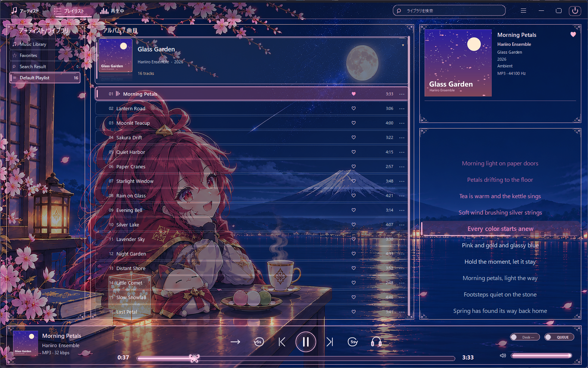
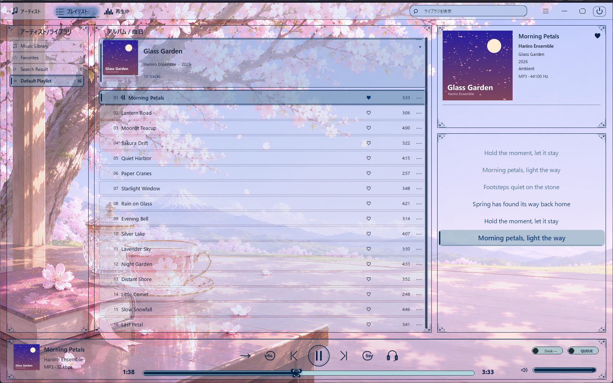
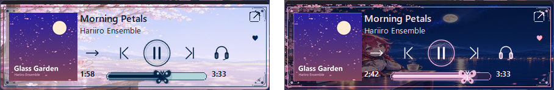

# Hariiro

[English](README.md) | 简体中文 | [日本語](README.ja.md)

基于 **Panels UI (reborn)** 和 JS Panel 的 foobar2000 透明“玻璃”风格皮肤：带封面和倒影的玻璃播放列表、
艺术家 / 媒体库 / 播放列表导航、可撤销的播放队列、本地歌词（ESLyric 保存的文件和标签，可按曲目调整偏移）、
图片化的播放控制、以文件夹形式扩展的主题色调（`images/controls/`，自带六种）、壁纸选择（`images/wallpapers/`）
以及九种界面语言（English、Español、Português、简体中文、繁體中文、日本語、Français、Deutsch、Русский）。
新安装默认使用 GLASS 模式。

当前版本：**1.0.1**（2026-11-28）：浅色壁纸的浅色界面、迷你播放器，移除了 NATIVE 视图。已在 foobar2000 2.26.3、foo_js_panel 1.9.2 和
Panels UI (reborn) 1.27.1 上测试。效果图使用的是虚构的示例专辑。

## 安装

1. 安装 [foobar2000](https://www.foobar2000.org/) v2（64 位）并启动一次。foobar2000 不随包提供：
   其许可只允许分发未经修改的安装程序。
2. 从[最新 Release](https://github.com/zainchung/Hariiro/releases/latest) 下载 `Hariiro.zip`，解压后双击 **`Install-Hariiro.cmd`**。它会找到 foobar2000，关闭前先征求同意，
   缺少时从 `components\` 添加 Panels UI (reborn) 和 JS Panel（已安装的不会被替换），把 `Hariiro\` 复制到
   `<profile>\foo_ui_panels-skins\Hariiro`（已有的会先备份），然后启动 foobar2000。不会修改任何设置和播放列表。
3. 首次启动点两下：在 “New user interface module(s) found” 中选择 **Panels UI (reborn)**，
   然后选择菜单 **View → Panels UI → Skins → Hariiro**（Panels UI 会先打开它自己的布局向导）。

手动安装、回退、切换语言和全部操作说明：[`docs/USER_README.zh-CN.txt`](docs/USER_README.zh-CN.txt)
（在压缩包中为 `Hariiro-README.zh-CN.txt`）。

## 主要功能

- **GLASS 列表**：按专辑分组的透明播放列表，带封面、倒影和心形收藏按钮。
- **迷你播放器**：只有封面、曲目信息、播放控制和进度条的小窗口（菜单 ☰）。
- **左侧栏**：艺术家或播放列表；新建、重命名、复制、移除、导入文件夹；Ctrl / Shift + 点击多选，Delete 删除。
- **拖放**：曲目拖到播放列表或队列；从资源管理器拖入文件和文件夹，自动排序并跳过重复项。
- **搜索媒体库**、**收藏**、**播放队列面板**（拖动排序、垃圾桶移除、清空）。
- **歌词**：带时间轴或纯文本，拖动跳转，按曲目提前 / 延后 0.5 秒，开关 ESLyric 桌面歌词。
- **撤销**：被删除的播放列表、曲目和队列项可通过 8 秒提示或 **Ctrl+Z** 恢复。
- **主题色调**和**壁纸**可通过放入文件夹 / 图片自行扩展；**九种语言**（菜单 ☰ → 皮肤语言）。
- **界面配色**：根据壁纸明暗自动切换浅色 / 深色界面，也可固定（菜单 ☰ → 界面配色）。

提问和建议请到 [讨论区](https://github.com/zainchung/Hariiro/discussions)；问题反馈请提 [Issue](https://github.com/zainchung/Hariiro/issues)。

## 许可

以 [MIT 许可证](LICENSE) 发布，Copyright (c) 2026 zainchung，适用于脚本、布局、文档和全部自带图片
（控件、边角和两张壁纸）。该许可不授予修改版使用 “Hariiro” 名称的权利。Release 压缩包按各自的 MIT 许可
原样附带 Panels UI (reborn) 和 foo_js_panel（`components\`、`THIRD-PARTY-NOTICES.txt`）。
foobar2000 和 ESLyric 不随包提供，请按其各自的许可另行安装。

开发相关内容（仓库结构、测试、打包）见英文 [README](README.md)。
